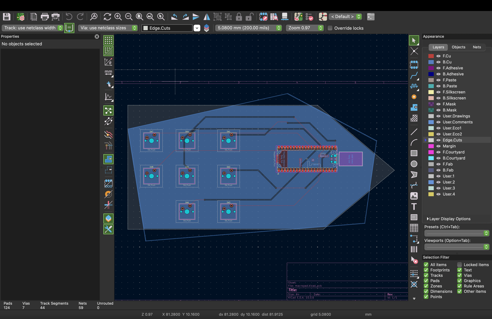

# Macropd
Making a customizable Macropad for quick operations on PCB. you will find all the PCB files
Also their are part names and links provided in bom.csv and every thing related to PCB like schematic file etc is provided.

[Uploading macropad.kicad_sch…]()

